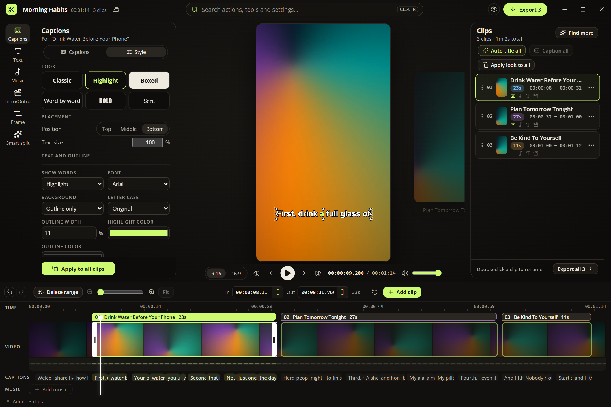
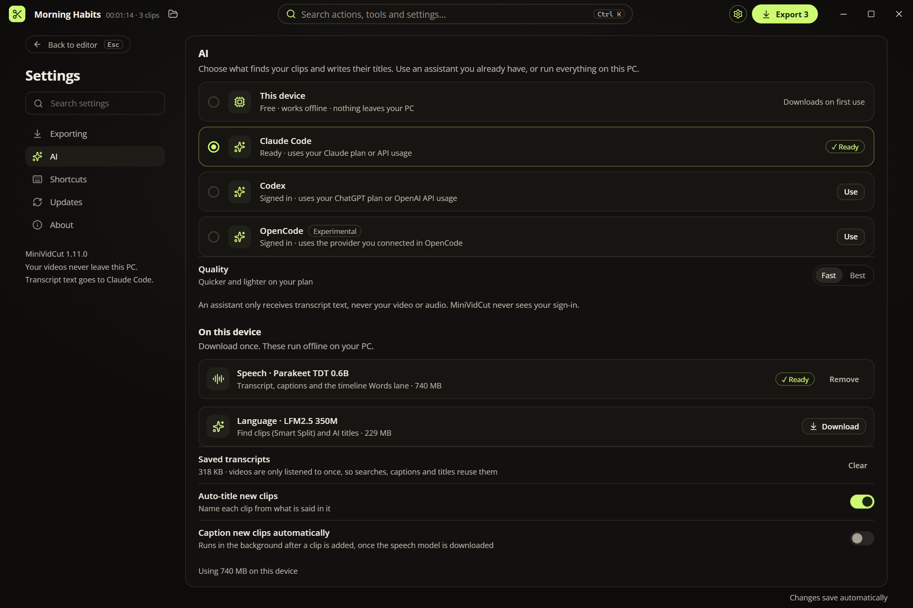

# MiniVidCut

**Turn long videos into shorts with less editing.**

Describe the clips you want, like “the funniest moments under 30 seconds,” and **Smart Split** finds them in your video’s transcript. Preview each suggestion, add captions and titles, then export vertical or landscape shorts.

Installers are currently unsigned, so Windows SmartScreen may warn on download. Choose **More info → Run anyway**. Installed copies update themselves in the background and ask before restarting.

## What you can do

- **Find clips by describing them.** Pick a quick search such as key takeaways, funny moments or tips, or type your own. Suggestions are ranked, each with a short reason, and appear on the timeline so you can preview them before adding.
- **Add captions that look right.** Automatic captions, editable word by word, in six looks (Classic, Highlight, Boxed, Word by word, Bold, Serif) with your choice of position, size, font and outline. Apply one look to every clip.
- **Name clips automatically.** Titles are written from what is said in each clip, and you can edit any of them.
- **Finish each clip.** Add up to 50 text blocks, import your own music with its own volume, start point and fades, and add an intro or outro. Reframe the picture to fill or fit.
- **Export in bulk.** Save every clip in one go as vertical 9:16 or landscape 16:9, at compact, compatible or lossless quality.

## A closer look

**Find clips.** Search by what you want, set a maximum length, and review suggestions next to the player.

**Style captions.** Choose a look, then adjust placement, size and outline. The caption in the preview updates as you go.

**Use the AI you already have.** Clips and titles are found on your PC by default. If you already use Claude Code, Codex or OpenCode, choose it in **Settings → AI** and click **Sign in**.

## Private by default

Your videos never leave your PC. Speech recognition and the default clip finder run on your computer after a one-time model download. If you choose an assistant in Settings, only the transcript text is sent to it, never your video or audio, and MiniVidCut never sees your sign-in. Usage counts toward your own plan or API key.

---

Built by [↗](https://github.com/ritechoice23) **Daramola Babatunde**. [↗](LICENSE) **MIT license**
