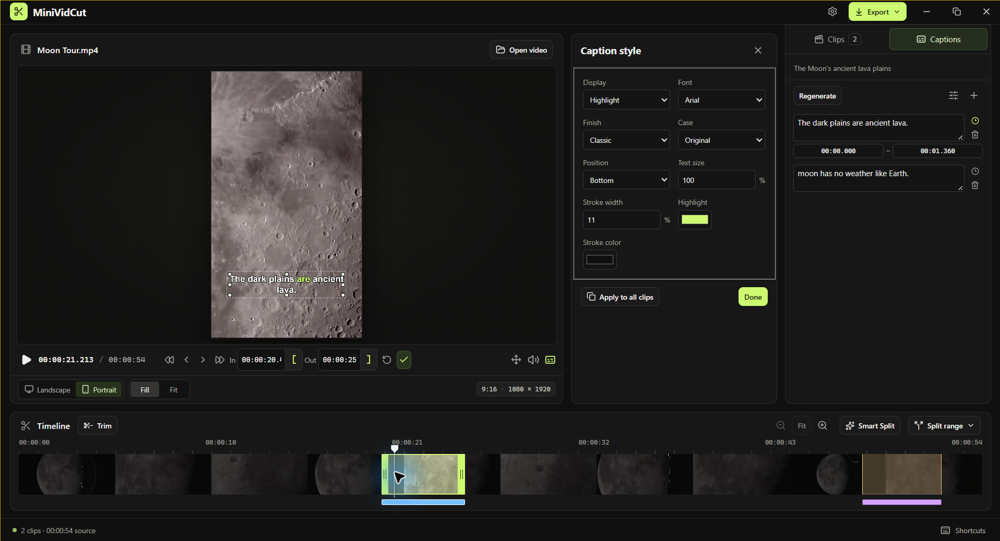

# MiniVidCut

**Turn long videos into shorts with less editing.**

Tell **Smart Split** what you’re looking for, like “the funniest moments under 30 seconds.” AI searches the transcript and suggests clips you can preview and trim. Add automatic captions and editable titles, then export your picks together in vertical or landscape format.

The AI runs on your PC after you download the models you need. Your videos stay on your device.

[↗](https://github.com/ritechoice23/minividcut/releases/latest) **Download for Windows x64**

Built by [↗](https://github.com/ritechoice23) **Daramola Babatunde**. [↗](LICENSE) **MIT license**

## MiniVidCut in action

**Find and save clips with Smart Split.** Review AI suggestions next to the player and see your saved clips on the timeline.

**Edit captions in the preview.** Fine-tune the words and timing while you review suggested moments.

**Style captions for vertical video.** Highlight words as they’re spoken and apply the same style across clips.

Demo visuals from [↗](https://svs.gsfc.nasa.gov/4619/) **NASA’s Scientific Visualization Studio**, with added narration.
