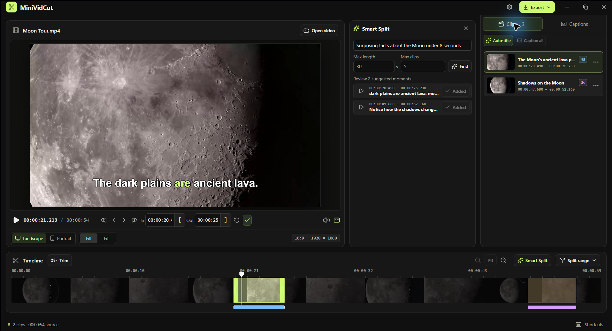
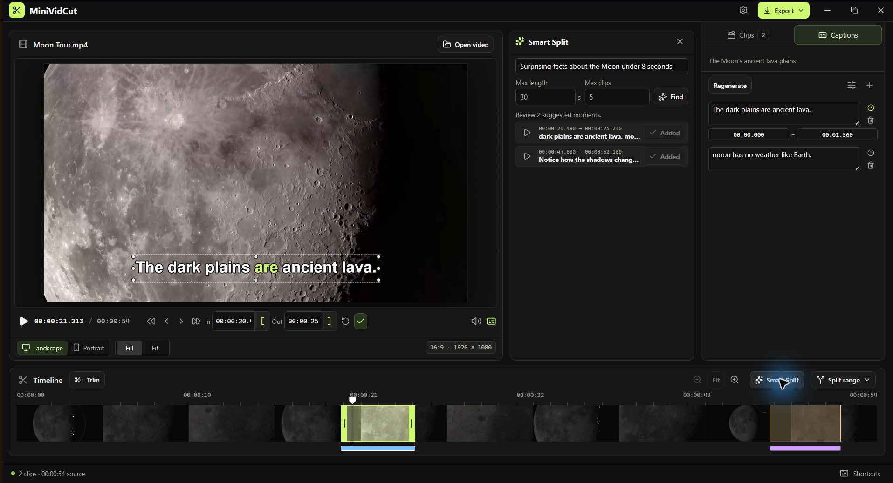

# MiniVidCut

**Turn long videos into shorts with less editing.**

Tell **Smart Split** what you’re looking for, like “the funniest moments under 30 seconds.” AI searches the transcript and suggests clips you can preview and trim. Add automatic captions, editable titles, and text overlays you can size and position by hand, then export your picks together in vertical or landscape format.

The AI runs on your PC after you download the models you need. Your videos stay on your device.

[↗](https://github.com/ritechoice23/minividcut/releases/latest) **Download for Windows x64**

Built by [↗](https://github.com/ritechoice23) **Daramola Babatunde**. [↗](LICENSE) **MIT license**

## MiniVidCut in action

**Find and save clips with Smart Split.** Review AI suggestions next to the player and see your saved clips on the timeline.

**Edit captions in the preview.** Fine-tune the words and timing while you review suggested moments.

**Style captions for vertical video.** Highlight words as they’re spoken and apply the same style across clips.

**Put text exactly where you want it.** Open the Text panel for a clip and add up to 50 separate text blocks. Each one has its own words (up to 4,000 characters), size, font, colour and position — select a block to edit it, then drag just that block on the preview or use the position sliders. Only the clips you choose get text, and it is burned into the exported video in either format.

**Keep your own music.** Import a local track into a personal library that still works after you move the original file, then set its volume, start point and fades for the whole project or a single clip.

Demo visuals from [↗](https://svs.gsfc.nasa.gov/4619/) **NASA’s Scientific Visualization Studio**, with added narration.
